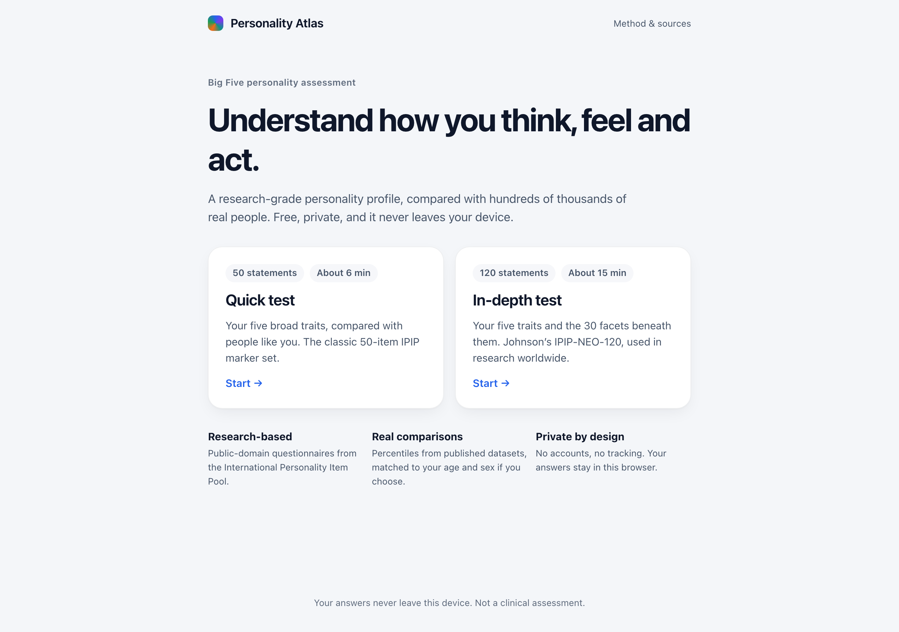
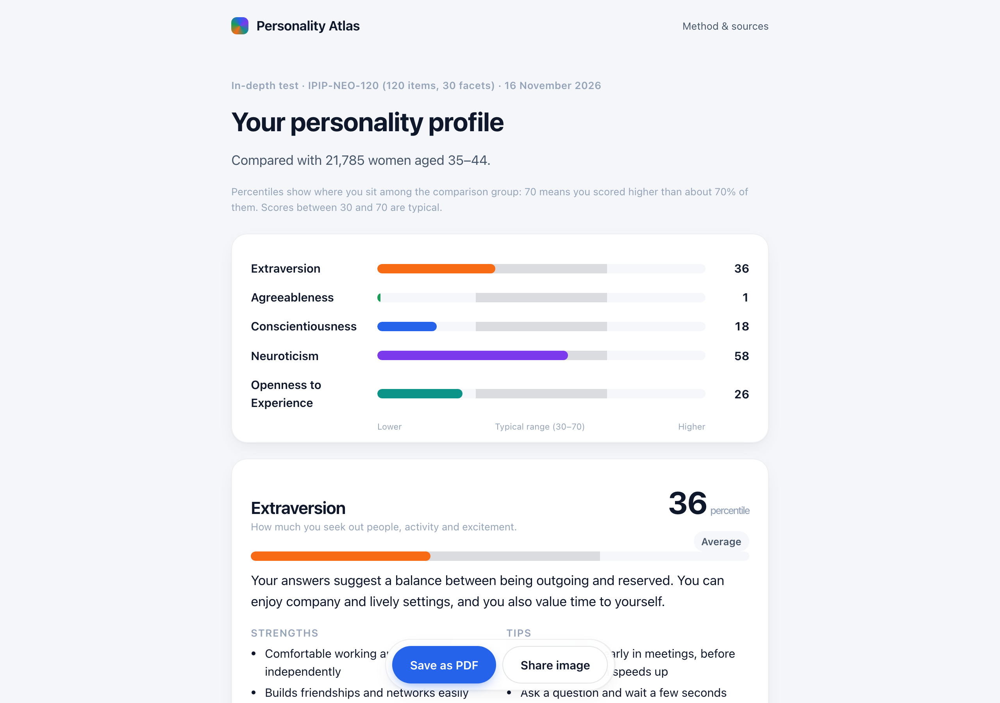
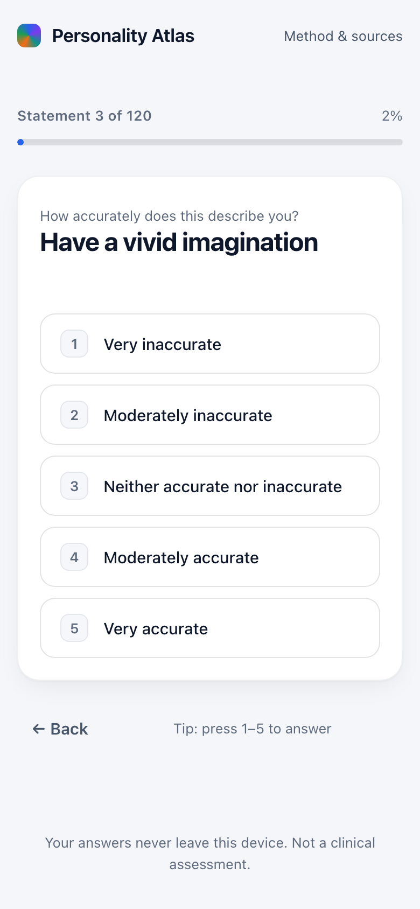
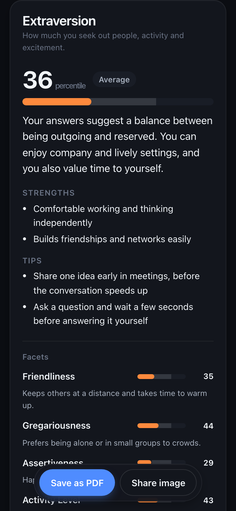
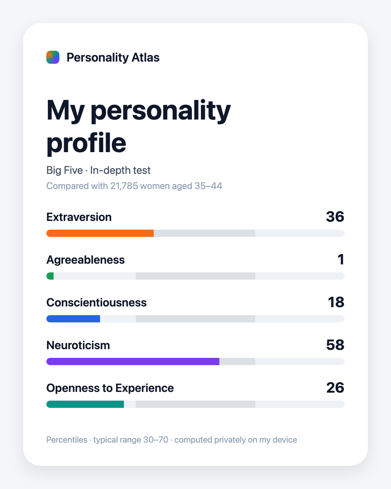

# Personality Atlas

A research-grade Big Five personality assessment that runs entirely in your browser. It is free and private, and every number is traceable to a published source.

<p align="center">
  
  
</p>
<p align="center">
  
  
  
</p>

## Two tests

| | Statements | Measures | Source |
|---|---|---|---|
| **Quick** | 50 (≈6 min) | 5 traits | IPIP Big-Five Factor Markers (Goldberg, 1992) |
| **In-depth** | 120 (≈15 min) | 5 traits + 30 facets | IPIP-NEO-120 (Johnson, 2014) |

Both questionnaires are in the public domain. Items and scoring keys are copied unchanged from the [International Personality Item Pool](https://ipip.ori.org/) and from Johnson's official item key on [OSF](https://osf.io/tbmh5/).

## How accurate is it?

- **Real comparisons.** Percentiles come from empirical norms built from actual respondents. They are not based on the midpoint of the scale.
  - In-depth: **410,376** people from Johnson's IPIP-NEO-120 dataset, after excluding anyone who skipped a statement.
  - Quick: **19,634** people from the Open-Source Psychometrics Project's dataset for the same 50 items.
- **Matched groups.** Visitors can give their age band and sex and be compared with matching people. A group must contain at least 500 people, otherwise the comparison falls back to a broader group. The report always names the group used and its size.
- **Checked.** A percentile from the app was recomputed independently from the raw data, and the two matched exactly.
- **Honest report text.** Outcome claims come only from associations that replicated in Soto's (2019) preregistered *Life Outcomes of Personality Replication Project*. They are shown as tendencies across many people, not predictions about one person.
- **Ages 10+.** Self-reports become valid from about age 10 (Soto et al., 2008). Ages 10–13 take the In-depth test against their own age-group norms, and their report says these results are less reliable. Under-10s are not tested.

Full method, caveats and sources are on the site's **Method & sources** page.

## Privacy

There are no accounts, cookies or analytics. The test runs entirely in your browser, and answers are kept on your device so you can resume.

At the end of the report you can **choose** to send your result to the researcher:
- **What is sent:** your name (required), email (optional), age band, sex, answers and scores.
- **Where it goes:** a private Google Sheet, through a small Apps Script in `server/`.
- **Under-18s:** a parent or guardian's name and consent are needed.
- **What it's used for:** the researcher's own insight only. It is never published or shared.

Nothing leaves your device unless you press **Send**. The PDF and the share image are made on your device and are never uploaded.

## Run it locally

```bash
npm run serve        # http://127.0.0.1:8765
npm install          # dev only: Playwright for end-to-end tests
npm test             # unit tests (scoring, norms, content)
npm run e2e          # browser tests
```

Rebuilding the norm tables needs the raw datasets in `raw/`, which are not committed. See `scripts/build-norms.mjs` for download links, then run `npm run norms`.

## Sources

- Goldberg, L. R. (1992). *Psychological Assessment*, 4, 26–42.
- Johnson, J. A. (2014). *Journal of Research in Personality*, 51, 78–89. Data: osf.io/tbmh5
- Open-Source Psychometrics Project, BIG5 dataset. openpsychometrics.org/_rawdata
- Soto, C. J. (2019). *Psychological Science*, 30, 711–727.
- Soto, C. J., John, O. P., Gosling, S. D., & Potter, J. (2008). *JPSP*, 94, 718–737.

Code: MIT. Not a clinical assessment.
